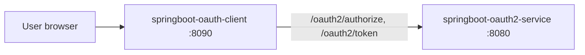

# SpringSecurity

A collection of Spring Boot sample projects demonstrating Spring Security: filter chains, custom authentication, method security, JWT, and OAuth 2.0 with Spring Authorization Server.

The projects range from basic authentication to OAuth2, JWT tokens and custom authentication providers. All of them have been upgraded to Spring Boot 3.5.7 and Spring Security 6.x with Jakarta EE standards.

## 🚀 Quick Start

Each module is a standalone Maven project. Build and run one (here `spring-security-filter-chain`):

```bash
cd spring-security-filter-chain

./buildMaven.sh          # or: mvn clean package
./runMaven.sh            # or: java -jar target/spring-security-filter-chain.jar
```

The app listens on `http://localhost:8080`. Default users:

| Username | Password | Roles |
| -------- | -------- | ----- |
| `user` | `userPass` | USER |
| `admin` | `adminPass` | ADMIN, USER |

For prerequisites and per-module settings, see **📋 Prerequisites & Dependencies** and **⚙️ Build & Configuration** below.

### Usage

```bash
mvn -B -ntp test         # run a module's unit tests
mvn clean package        # build the jar (or war for spring-security-web-login)
```

### Output

| Module | Default address |
| ------ | --------------- |
| `spring-security-filter-chain` | `http://localhost:8080` |
| `spring-security-web-login` | `http://localhost:8081` (`http://localhost:8082/spring-security-web-login` with Cargo) |
| `spring-oauth-clients/springboot-oauth2-service` | `http://localhost:8080` |
| `spring-oauth-clients/springboot-oauth-client` | `http://localhost:8090` |
| `jwt-authentications/jwt-authentication4` | `http://localhost:8080` |

The other modules use Spring Boot's default port `8080`.

## ✨ Features

- **Modern configuration** — `SecurityFilterChain` beans and the lambda DSL, replacing `WebSecurityConfigurerAdapter`
- **Custom authentication** — a custom filter, provider and token with domain-based login
- **Method security** — `@EnableMethodSecurity` with a custom `AuthorizationManager` and `@Policy` annotation
- **JWT** — several implementations of token-based authentication, plus JWT-based CSRF protection
- **OAuth 2.0** — an authorization server and a client built on Spring Authorization Server
- **Modern stack** — Java 21, Spring Boot 3.5.7, Spring Security 6.x and Jakarta EE (migrated from `javax`)

### Limits

Some projects in this repository are duplicates or very similar. [DUPLICATE_ANALYSIS.md](DUPLICATE_ANALYSIS.md) is a detailed analysis of:

- Which projects are duplicates
- What makes them similar or different
- Recommendations on which projects to keep or remove
- A comparison matrix of all `jwt-authentication` projects

## 📋 Prerequisites & Dependencies

- Java 21
- Maven 3.6+ (3.8+ for `spring-oauth-clients`)
- MySQL or PostgreSQL (optional — some JWT modules support them; tests use in-memory H2)
- Docker (optional — `jwt-authentications/jwt-authentication4` ships a `docker-compose.yml`)

| Technology | Version |
| ---------- | ------- |
| Java | 21 |
| Spring Boot | 3.5.7 |
| Spring Security | 6.x |
| Jakarta EE | 9+ (migrated from `javax`) |

| Source | Purpose |
| ------ | ------- |
| `pom.xml` | Dependencies of each module — resolved by Maven during the build |
| `jwt-authentications/jwt-authentication6` | Needs the `com.rslakra.appsuite` artifacts, which are not on Maven Central — see **🛠️ Troubleshooting** |

## ⚙️ Build & Configuration

### Build

```bash
cd <module>
./buildMaven.sh          # or: mvn clean package
```

Where the output lands: `<module>/target/` (a jar, or a war for `spring-security-web-login`). `component-based-security` also ships `buildGradle.sh`, and `jwt-authentications/jwt-authentication7` also has `build.sh`.

### Run

```bash
cd <module>
./runMaven.sh            # or: java -jar target/<module>.jar
```

For `spring-oauth-clients`, start `springboot-oauth2-service` first, then `springboot-oauth-client`.

### Settings

Configuration lives in each module's `src/main/resources/application.properties` (or `application.yml`).

| Module | Setting | What it does |
| ------ | ------- | ------------ |
| `spring-oauth-clients/springboot-oauth2-service` | `oauth.client.id`, `oauth.client.secret`, `oauth.client.redirect-uris`, `oauth.client.scopes` | OAuth client the authorization server accepts |
| `spring-oauth-clients/springboot-oauth2-service` | `application-mysql.properties` | MySQL profile for the authorization server |
| `jwt-authentications/jwt-authentication1`, `3`, `5`, `6` | `app.jwtSecret`, `app.jwtExpirationInMillis` | JWT signing secret and token lifetime |
| `jwt-authentications/jwt-authentication4` | `jwt.secret-key`, `jwt.validity-in-millis` | JWT signing secret and token lifetime |

### Default credentials

Sample values for local use only.

| Module | Username | Password | Role |
| ------ | -------- | -------- | ---- |
| `spring-security-filter-chain` | `user` | `userPass` | USER |
| `spring-security-filter-chain` | `admin` | `adminPass` | ADMIN, USER |
| `spring-oauth-clients/springboot-oauth2-service` | `admin` | `admin123` | ROLE_ADMIN |
| `spring-oauth-clients/springboot-oauth2-service` | `user` | `user123` | ROLE_USER |

### Security

The secrets and passwords in these samples are demo values. Never reuse them in a real deployment, and never commit real keys or credentials.

### Migration notes

All projects have been upgraded from Spring Boot 2.x to 3.5.7 with the following changes.

1. **Jakarta EE migration**
   - `javax.servlet` → `jakarta.servlet`
   - `javax.persistence` → `jakarta.persistence`
   - `javax.transaction` → `jakarta.transaction`

2. **Spring Security 6.x**
   - `WebSecurityConfigurerAdapter` → `SecurityFilterChain` beans
   - `authorizeRequests()` → `authorizeHttpRequests()`
   - `antMatchers()` → `requestMatchers()`
   - Lambda DSL for configuration

3. **Dependencies**
   - Thymeleaf Spring Security extras: 5 → 6
   - JSP/JSTL: `javax.servlet.jsp.jstl` → `jakarta.servlet.jsp.jstl`
   - Removed explicit Spring Security dependencies (managed by Spring Boot)

4. **Testing**
   - Updated to use `@SpringBootTest` instead of XML-based configuration
   - Modern JUnit 5 testing

## 📁 Project Layout

```
SpringSecurity/
├── component-based-security/       # JWT authentication with component-based security configuration
├── enable-method-security/         # @EnableMethodSecurity with a custom AuthorizationManager
├── java-jwt-based-security/        # JWT features and JWT-based CSRF protection (JJWT)
├── jwt-authentications/            # Several JWT authentication implementations
│   ├── jwt-authentication1/
│   ├── jwt-authentication3/
│   ├── jwt-authentication4/
│   ├── jwt-authentication5/
│   ├── jwt-authentication6/
│   └── jwt-authentication7/
├── spring-oauth-clients/           # OAuth 2.0 authorization server and client
│   ├── springboot-oauth-client/
│   └── springboot-oauth2-service/
├── spring-security-filter-chain/   # SecurityFilterChain configuration
├── spring-security-web-login/      # Custom authentication filter and provider
├── DUPLICATE_ANALYSIS.md           # Analysis of duplicate JWT projects
└── README.md                       ← you are here
```

Each module follows the usual Maven layout (`src/main`, `src/test`, `pom.xml`) plus `buildMaven.sh` and `runMaven.sh`.

### Modules

| Module | What it demonstrates | Key tech |
| ------ | -------------------- | -------- |
| `spring-security-filter-chain` | `SecurityFilterChain`, role-based access (USER, ADMIN), form login, a custom entry point (401 for API, redirect for browsers) | Thymeleaf, H2 |
| `spring-security-web-login` | `PasswordAuthenticationFilter`, `UserDetailsAuthenticationProvider` and `PasswordAuthenticationToken` with domain-based login, BCrypt | Thymeleaf, WAR packaging |
| `spring-oauth-clients` | Authorization code flow between an authorization server and a client | Spring Authorization Server, JSP/JSTL |
| `java-jwt-based-security` | JWT generation and validation, JWT-based CSRF protection, an API explorer UI | JJWT, Thymeleaf |
| `jwt-authentications` | Several JWT authentication implementations | Spring Data JPA, JJWT |
| `component-based-security` | JWT authentication with stateless sessions and BCrypt | JJWT, H2, MySQL |
| `enable-method-security` | `@EnableMethodSecurity`, a `@Policy` annotation and HTTP Basic authentication | Spring Security |

### Module features

**`spring-security-filter-chain`** — modern `SecurityFilterChain` configuration, replacing the deprecated `WebSecurityConfigurerAdapter`.

- Spring Security 6.x lambda DSL
- Role-based access control (USER, ADMIN)
- Form-based authentication
- Custom authentication entry point (401 for API, redirect for browsers)
- Thymeleaf templates with modern UI
- Tech: Spring Boot 3.5.7, Thymeleaf, H2 Database

**`spring-security-web-login`** — custom authentication filter and provider, with domain-based authentication support.

- Custom `PasswordAuthenticationFilter` extending `UsernamePasswordAuthenticationFilter`
- Custom `UserDetailsAuthenticationProvider` for authentication
- Custom `PasswordAuthenticationToken` supporting domain-based authentication
- BCrypt password encoding
- Thymeleaf templates
- Tech: Spring Boot 3.5.7, Thymeleaf, WAR packaging
- Note: it uses Thymeleaf HTML templates (`src/main/resources/html/`). The JSP files in `src/main/webapp/WEB-INF/view/` are legacy and unused.

**`spring-oauth-clients`** — a complete OAuth2 implementation with Spring Authorization Server and an OAuth2 client.

- Sub-projects: `springboot-oauth2-service` (authorization server) and `springboot-oauth-client` (client application)
- Spring Authorization Server, replacing the deprecated Spring Security OAuth2
- JWT token customization
- Externalized OAuth client configuration
- Default user initialization
- JSP-based UI with fragments
- Tech: Spring Boot 3.5.7, Spring Authorization Server, JSP/JSTL

**`java-jwt-based-security`** — JWT token generation, validation and CSRF protection using the JJWT library.

- JWT token generation and validation
- CSRF protection using JWT
- API explorer interface
- Thymeleaf templates with modern UI
- Tech: Spring Boot, JJWT, Thymeleaf

**`jwt-authentications`** — a collection of JWT authentication examples with different approaches and configurations.

- Sub-projects: `jwt-authentication1`, `3`, `4`, `5`, `6` and `7` (there is no `jwt-authentication2`)
- Various JWT implementation patterns, all upgraded to Spring Boot 3.5.7
- Tech: Spring Boot 3.5.7, Spring Security 6.x, JJWT, JPA

**`component-based-security`** — the component-based approach to Spring Security configuration.

**`enable-method-security`** — `@EnableMethodSecurity` and method-level authorization annotations.

### JWT authentication variants

| Module | What sets it apart |
| ------ | ------------------ |
| `jwt-authentication1` | Clean implementation with roles `ROLE_USER`, `ROLE_MODERATOR` and `ROLE_ADMIN` |
| `jwt-authentication3` | The same approach with different class names |
| `jwt-authentication4` | Vehicle/Brand domain model and a different JWT security configuration |
| `jwt-authentication5` | Adds a static HTML login UI |
| `jwt-authentication6` | The same approach as `jwt-authentication1`, plus the AppSuite libraries |
| `jwt-authentication7` | A different package layout with a custom `UserDetails` |

### Project status

| Project | Spring Boot | Status | Notes |
| ------- | ----------- | ------ | ----- |
| `spring-security-filter-chain` | 3.5.7 | ✅ Upgraded | Modern UI, all tests passing |
| `spring-security-web-login` | 3.5.7 | ✅ Upgraded | Custom auth, tests passing |
| `spring-oauth-clients` | 3.5.7 | ✅ Upgraded | Spring Authorization Server |
| `java-jwt-based-security` | 3.5.7 | ✅ Upgraded | JWT with CSRF protection |
| `jwt-authentications/*` | 3.5.7 | ✅ Upgraded | Multiple JWT implementations |
| `component-based-security` | 3.5.7 | ✅ Upgraded | Component-based security |
| `enable-method-security` | 3.5.7 | ✅ Upgraded | Method-level security |

## 🏗️ Architecture

The OAuth modules form a client / authorization-server pair:



### Components

| ID | Component | Module |
| -- | --------- | ------ |
| C1 | OAuth 2.0 authorization server (JWT access tokens, OIDC discovery, user REST API) | `spring-oauth-clients/springboot-oauth2-service` |
| C2 | OAuth 2.0 client with JSP views (authorization code flow) | `spring-oauth-clients/springboot-oauth-client` |

### Data flow

1. The user opens `http://localhost:8090/getEmployees` on the client.
2. The client redirects to `/oauth2/authorize` on the authorization server.
3. The user signs in and the server redirects back with an authorization code.
4. The client calls `POST /oauth2/token` and receives a JWT access token.
5. The client shows the employee list at `/showEmployees`.

## 🧪 Testing

```bash
cd <module>
mvn -B -ntp test
```

The tests run on in-memory H2 where a database is involved.

### Continuous integration

There is one GitHub Actions workflow in `.github/workflows/` (at the repository root) for each folder here. Their filenames start with `springsecurity-`, followed by the folder name. Each runs `mvn -B -ntp test` on JDK 21 (Temurin):

| Workflow | Modules |
| -------- | ------- |
| `springsecurity-component-based-security-ci.yml` | `component-based-security` |
| `springsecurity-enable-method-security-ci.yml` | `enable-method-security` |
| `springsecurity-java-jwt-based-security-ci.yml` | `java-jwt-based-security` |
| `springsecurity-jwt-authentications-ci.yml` | `jwt-authentication1`, `3`, `4`, `5`, `7` |
| `springsecurity-spring-oauth-clients-ci.yml` | `springboot-oauth-client`, `springboot-oauth2-service` |
| `springsecurity-spring-security-filter-chain-ci.yml` | `spring-security-filter-chain` |
| `springsecurity-spring-security-web-login-ci.yml` | `spring-security-web-login` |

`jwt-authentication6` is excluded; see below.

## 🛠️ Troubleshooting

| Issue | Fix |
| ----- | --- |
| Port already in use | Stop the other process, or set `server.port` in the module's `application.properties` |
| Build fails on a Java version error | Use JDK 21 — `java -version` shows the current one |
| `jwt-authentication6` can't resolve `com.rslakra.appsuite:appsuite-core` or `appsuite-spring` | These are not on Maven Central and the pom declares no repository. They resolve locally only if installed in `~/.m2`. Install them first, or publish them to a repository |

## 🤝 Contributing

When upgrading projects:

1. Update Spring Boot to 3.5.7
2. Migrate `javax` to `jakarta`
3. Update Spring Security to 6.x lambda DSL
4. Update dependencies
5. Fix compilation errors
6. Update tests
7. Update README.md

## 📚 References

### In this repository

Each module contains its own `README.md` with its features, build and run instructions, configuration details, API endpoints and default credentials.

| Module | Link | Description |
| ------ | ---- | ----------- |
| `component-based-security` | [component-based-security/README.md](component-based-security/README.md) | JWT authentication with component-based security configuration |
| `enable-method-security` | [enable-method-security/README.md](enable-method-security/README.md) | Method-level security with a custom `AuthorizationManager` |
| `java-jwt-based-security` | [java-jwt-based-security/README.md](java-jwt-based-security/README.md) | JWT features and JWT-based CSRF protection |
| `jwt-authentications` | [jwt-authentications/README.md](jwt-authentications/README.md) | Several JWT authentication implementations |
| `jwt-authentications/jwt-authentication1` | [jwt-authentications/jwt-authentication1/README.md](jwt-authentications/jwt-authentication1/README.md) | JWT authentication with roles USER, MODERATOR and ADMIN |
| `jwt-authentications/jwt-authentication3` | [jwt-authentications/jwt-authentication3/README.md](jwt-authentications/jwt-authentication3/README.md) | JWT authentication with alternative class naming |
| `jwt-authentications/jwt-authentication4` | [jwt-authentications/jwt-authentication4/README.md](jwt-authentications/jwt-authentication4/README.md) | Protecting REST APIs with JWT, using a Vehicle/Brand domain |
| `jwt-authentications/jwt-authentication5` | [jwt-authentications/jwt-authentication5/README.md](jwt-authentications/jwt-authentication5/README.md) | JWT authentication with a static HTML UI |
| `jwt-authentications/jwt-authentication6` | [jwt-authentications/jwt-authentication6/README.md](jwt-authentications/jwt-authentication6/README.md) | JWT authentication using the AppSuite libraries |
| `jwt-authentications/jwt-authentication7` | [jwt-authentications/jwt-authentication7/README.md](jwt-authentications/jwt-authentication7/README.md) | JWT authentication with a different package layout |
| `spring-oauth-clients` | [spring-oauth-clients/README.md](spring-oauth-clients/README.md) | OAuth 2.0 authorization server and client |
| `spring-oauth-clients/springboot-oauth-client` | [spring-oauth-clients/springboot-oauth-client/README.md](spring-oauth-clients/springboot-oauth-client/README.md) | OAuth 2.0 client with JSP views |
| `spring-oauth-clients/springboot-oauth2-service` | [spring-oauth-clients/springboot-oauth2-service/README.md](spring-oauth-clients/springboot-oauth2-service/README.md) | OAuth 2.0 authorization server on Spring Authorization Server |
| `spring-security-filter-chain` | [spring-security-filter-chain/README.md](spring-security-filter-chain/README.md) | `SecurityFilterChain` configuration |
| `spring-security-web-login` | [spring-security-web-login/README.md](spring-security-web-login/README.md) | Custom authentication filter and provider |

### External Documentation

| Link | Description |
| ---- | ----------- |
| [Spring Security Documentation](https://docs.spring.io/spring-security/reference/index.html) | Spring Security reference |
| [Spring Boot Documentation](https://docs.spring.io/spring-boot/docs/current/reference/html/) | Spring Boot reference |
| [Spring Authorization Server](https://docs.spring.io/spring-authorization-server/reference/) | Authorization server reference |
| [Jakarta EE Migration Guide](https://jakarta.ee/specifications/servlet/6.0/) | `javax` to `jakarta` migration |

## 📄 License

These are educational examples and demonstrations of Spring Security features.

## 👤 Author

- **Rohtash Lakra** — [@rslakra](https://github.com/rslakra)
